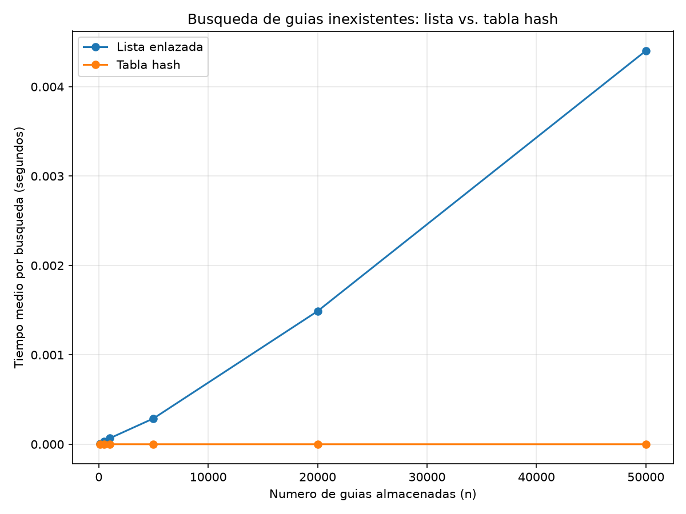
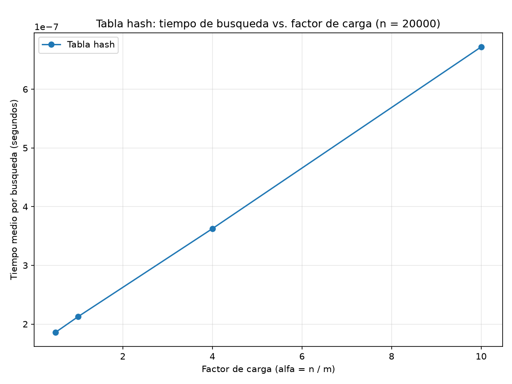

# Laboratorio 3 — Estructuras de datos

**Nombre completo:** David Viloria
**Correo:** david_viloria04@hotmail.com
**Semestre:** 2026-2
**Caso analizado:** Rutas del Caribe — mensajería, consulta de guías de envío.

## Instrucciones de reproducción

El entorno virtual vive en la raíz del repositorio (`curso-analisis-algoritmos/`),
un nivel arriba de esta carpeta.

```bash
# 1. Ubicarse en la raíz del repositorio
cd curso-analisis-algoritmos

# 2. Crear el entorno virtual (si no existe) y activarlo
python -m venv .venv
# Windows (PowerShell):
.venv\Scripts\Activate.ps1
# Linux / Mac:
source .venv/bin/activate

# 3. Instalar dependencias
pip install -r requirements.txt

# 4. Ubicarse en la carpeta de este laboratorio
cd lab3-estructuras-datos

# 5. Correr las pruebas de correctitud
python pruebas.py

# 6. Correr los experimentos de medicion (genera graficas/lista_vs_tabla.png
#    y graficas/tiempo_vs_alfa.png)
python medicion.py
```

---

## Parte 1 — Implementar y verificar las dos estructuras

Código de esta parte: [estructuras.py](estructuras.py) y [pruebas.py](pruebas.py).

`ListaEnlazada` inserta siempre al inicio (Θ(1)) y busca recorriendo desde
la cabeza con un ciclo `while` (iterativo, para no toparse con el límite de
recursión de Python en listas largas). `TablaHash` reutiliza
`ListaEnlazada` como la lista de cada casilla (encadenamiento): `hash`
calcula `guia % m` por el método de la división, `insertar` delega en la
lista de la casilla calculada, y `buscar` recorre solo esa lista, nunca la
tabla completa.

`pruebas.py` verifica con `assert`:

- Una búsqueda exitosa y una infructuosa, tanto en la lista como en la
  tabla.
- La colisión forzada del enunciado: con `m=7`, las guías 10, 24 y 17 caen
  las tres en la casilla 3 (`10 % 7 = 24 % 7 = 17 % 7 = 3`); se verifica
  que las tres quedan accesibles después de insertarse y que
  `casillas[3].tamano == 3`.
- Que `factor_carga()` da exactamente `3 / 7` tras esas tres inserciones.
- Veinte colecciones aleatorias de tamaño y `m` variables (semilla fija),
  en las que la lista y la tabla deben coincidir tanto para guías
  existentes como para guías inexistentes.

Las verificaciones pasan (`python pruebas.py` imprime "Todas las pruebas
pasaron."), y el código cumple `flake8` sin advertencias.

---

## Parte 2 — Medir y graficar

Código de esta parte: [medicion.py](medicion.py).

**Experimento A — lista vs. tabla.** Para n = 100, 500, 1000, 5000, 20000 y
50000, se construyen una `ListaEnlazada` y una `TablaHash` con las mismas
guías (semilla fija, enteros de diez dígitos distintos), usando en la tabla
m primo cercano a n/2 (α ≈ 2 en los seis tamaños). Se miden 200 búsquedas
de guías inexistentes (generadas con la función provista) por estructura,
repitiendo la ronda 3 veces y tomando la mediana del tiempo total dividida
entre 200, cronometrando solo las llamadas a `buscar`. El experimento
verifica además, para una muestra de guías existentes, que la lista y la
tabla devuelven el mismo estado.



| n | m | α | Lista enlazada (µs) | Tabla hash (µs) |
|---:|---:|---:|---:|---:|
| 100 | 47 | 2,128 | 6,302 | 0,470 |
| 500 | 251 | 1,992 | 31,993 | 0,486 |
| 1000 | 499 | 2,004 | 66,620 | 0,409 |
| 5000 | 2503 | 1,998 | 288,534 | 0,336 |
| 20000 | 10007 | 1,999 | 1489,096 | 0,370 |
| 50000 | 24989 | 2,001 | 4401,628 | 0,368 |

**Experimento B — efecto del factor de carga.** Con n = 20000 guías fijas,
se construyen cuatro tablas con m ajustado para α = 0,5; 1; 4 y 10, y se
mide el tiempo medio de 200 búsquedas de guías inexistentes en cada una,
con la misma metodología (3 repeticiones, mediana).



| α | m | Tabla hash (µs) |
|---:|---:|---:|
| 0,5 | 40000 | 0,186 |
| 1 | 20000 | 0,212 |
| 4 | 5000 | 0,363 |
| 10 | 2000 | 0,672 |

En la primera gráfica, la curva de la tabla queda pegada al eje horizontal
frente a la de la lista; por eso se incluye la tabla de valores exactos,
necesaria para leer la Parte 3.

---

## Parte 3 — Análisis

**1. Costo teórico.** Buscar una guía inexistente en la lista cuesta Θ(n)
porque, al no existir, el ciclo `while` no puede detenerse antes de
recorrer los n nodos: la lista no tiene orden ni índice que permita
descartar nodos. En la tabla, `buscar` calcula la casilla con `hash` en
O(1) y luego recorre solo la lista de esa casilla, cuyo largo esperado es
el factor de carga α = n/m; de ahí Θ(1 + α): el 1 es calcular el hash y
acceder al arreglo, y α es recorrer la cadena. Esto depende del supuesto
de **hash uniforme simple**: que la función reparte las guías de forma
pareja e independiente entre las m casillas, para que cada una reciba en
promedio n/m elementos. Si todas las guías cayeran en una sola casilla (un
hash degenerado), la tabla se convierte en una única lista enlazada de
tamaño n, y la búsqueda vuelve a costar Θ(n).

**2. Lo medido contra lo esperado.** Tomando n=100 y n=500 (n ×5): la
lista pasó de 6,302 µs a 31,993 µs, factor ×5,08 — casi el ×5 esperado
para Θ(n). De n=20000 a n=50000 (n ×2,5): la lista pasó de 1489,096 µs a
4401,628 µs, factor ×2,96, del mismo orden que ×2,5. La tabla se mantuvo
entre 0,33 y 0,49 µs en los seis tamaños, sin tendencia de crecimiento:
coherente con Θ(1) mientras α se mantiene fija (~2). En la segunda
gráfica, el tiempo de la tabla sube de 0,186 µs (α=0,5) a 0,672 µs
(α=10), un crecimiento claro y monótono con α, coherente en dirección con
Θ(1+α), aunque a esta escala (cientos de nanosegundos) el ruido de
medición pesa bastante y el ajuste no es perfectamente lineal.

**3. Colisiones.** Una colisión ocurre cuando dos guías distintas dan la
misma casilla al calcular `guia % m`; pasa aunque m sea mayor que n porque
nada impide que dos guías concretas compartan residuo módulo m (es el
fenómeno del problema del cumpleaños). El ejemplo del laboratorio lo
muestra con m=7: `10 % 7`, `24 % 7` y `17 % 7` dan los tres 3, así que
colisionan aunque la tabla tenga 7 casillas para solo 3 elementos. El
**encadenamiento** (el que implementé) guarda todos los elementos de una
casilla en una lista propia: nunca se llena y es simple de borrar, pero
cuesta memoria extra de punteros y, si una casilla concentra muchos
elementos, buscar en ella degenera a Θ(longitud de la cadena). El
**direccionamiento abierto** guarda el elemento colisionado en otra
casilla libre del mismo arreglo: ahorra esa memoria y mejora la localidad
de caché, pero la tabla se puede llenar, borrar es más delicado (requiere
marcas especiales) y el agrupamiento de sondeos puede degradar el
rendimiento.

**4. Tabla hash o árbol de búsqueda.** La tabla no sirve para el
monitoreo por rango: `hash` dispersa intencionalmente las guías, así que
dos guías numéricamente cercanas pueden caer en casillas distintas;
recuperar "guías entre X y Y" obligaría a revisar las m casillas
completas, Θ(n + m) — tan malo como la lista. Un árbol de búsqueda binario
sí sirve porque mantiene el orden (izquierda menor, derecha mayor): un
recorrido en orden restringido al rango cuesta O(h + k), con h la altura y
k el tamaño del resultado. El problema es que, si las 400.000 guías llegan
ya ordenadas y se insertan una a una sin balancear, cada guía es mayor que
todas las anteriores y el árbol degenera en una lista: altura ≈ 400.000 y
hasta 400.000 comparaciones por búsqueda, el mismo problema que se quería
resolver. Un árbol equilibrado (AVL o rojo-negro) garantiza altura ≈
log2(400.000) ≈ 19: unas 21.000 veces menos comparaciones en el peor caso.

**5. Concepto para la jefa de operaciones.** Recomiendo una combinación:
tabla hash para la consulta puntual del call center, y un árbol
equilibrado (AVL o rojo-negro) para el monitoreo por rango, manteniendo
ambas estructuras sobre los mismos envíos — ninguna cubre sola las dos
necesidades. Para estimar 5.000.000 de envíos uso la forma de cada curva,
no una regla de tres simple. La lista es Θ(n): escalando los 4401,628 µs
medidos en n=50000 por 5.000.000/50.000 = 100, una búsqueda tardaría ≈
440.163 µs ≈ **0,44 s**, ya notorio en una llamada. La tabla es Θ(1+α): si
se mantiene α≈2 creciendo m junto con n (como en el Experimento A), el
tiempo no depende de n y se espera que siga en el orden medido, **menos de
1 µs**. Es una estimación que asume mantener α acotado con rehashing; con
m fijo, α crecería sin control y la tabla también se degradaría.

---

## Estructura del repositorio de este laboratorio

```
lab3-estructuras-datos/
├── README.md
├── estructuras.py
├── pruebas.py
├── medicion.py
└── graficas/
    ├── lista_vs_tabla.png
    └── tiempo_vs_alfa.png
```
